# Panoptes

[Deutsch](README.md) · **English**

Panoptes is a free community app for BYD cars with DiLink 3, 4 and 5. It runs right on the car's screen, with large buttons made for use in the car. It also comes with a web interface you open on your phone or PC. Panoptes offers a camera guard, remote access, Telegram notifications, a map with chargers, a monthly report and a link to the route planner.

This is the source code. Ready-made versions are available under **[Releases](https://github.com/samuelvoltarius/panoptes/releases/latest)**. More about the project and the installation guide: **[byd.serveone.at/panoptes/](https://byd.serveone.at/panoptes/en/)**.

This tree corresponds exactly to release **v0.1.38.12** (internal commit `2eb84cf`).

<p>
  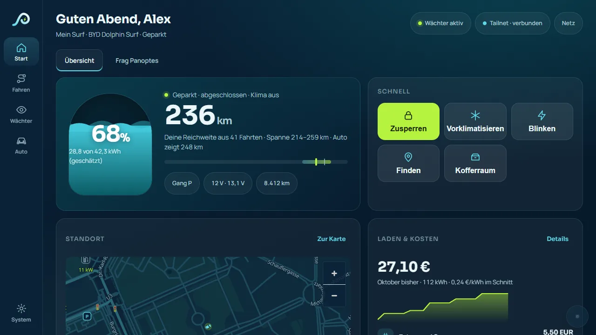
  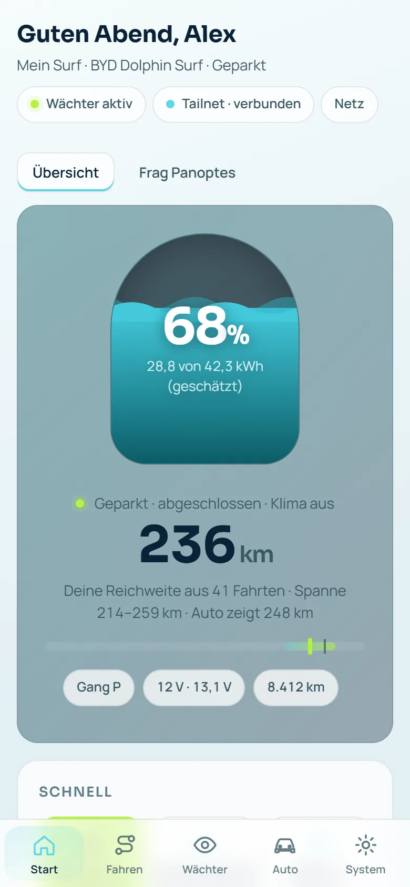
</p>

> **Important:** Panoptes is a private hobby project and not made by BYD. Please read the [notes](#hinweise--disclaimer) below before installing it.

The app is available in English, German, French, Italian and Dutch. The screenshots show the German interface.

---

## What Panoptes does

- **On the car screen.** Panoptes runs as its own full-screen app, with large buttons and a back button. While driving, settings are locked; home, navigation, map and guard stay available. While starting, Panoptes shows for each service (access, interface, guard, Telegram) whether it is running yet – also when it was started another way. The interface adapts to different screen sizes, including portrait.
- **Guard with AI detection.** While your car is parked, the cameras watch its surroundings. The guard is on by default and then records only on impact. It only runs once you have confirmed the legal note. You can change this at any time: only on impact, with AI detection everywhere, or with AI detection only at your own private places such as your garage or driveway. To protect the batteries, the guard can go to sleep, for example when the charge level is low or the starter battery is weak.
- **Remote access.** Reach your car from anywhere via Tailscale. Setup uses a QR code on the car screen; you link it to your own Tailscale account. If Panoptes cannot set the protection rule for remote access, it turns remote access off instead of leaving it open unprotected.
- **Telegram notifications.** Your own bot tells you what happens at the car: guard events, charging, weak starter battery, tyre pressure, updates. Each kind can be switched on or off. There are quiet hours for the night. The bot sends guard pictures and clips along by itself; turn it off with /bilder aus or in Panoptes. They are then stored on Telegram's servers. By default the bot is reachable even when the car is switched off. This uses a little power from the starter battery; if it gets weak, the bot goes to sleep by itself. Turn it off with /erreichbar aus.
- **Phone notifications without Telegram.** Notifications straight to your phone need an HTTPS address. With Tailscale, Panoptes can turn on HTTPS in your own tailnet for this: your car gets an address under ts.net that is not public. Without Tailscale you need your own fixed HTTPS address; Telegram always works.
- **Map with chargers.** You choose where the map comes from: the project's community server (with terrain and free charging spots where operators provide the data), OpenStreetMap, or none. Until you choose, the map stays empty.
- **"Will it make it?"** When you have loaded a route from the route planner, Panoptes tells you on the road whether the battery will last to the next stop. If needed, it suggests a charging stop.
- **Monthly report.** Distance, consumption, charging and costs, standby loss and guard events of a month at a glance, also for printing. Calculated in the car.
- **Trips and charging.** Trips, consumption and charging costs are recorded in the car and shown clearly.
- **Route planner link.** You can connect Panoptes to your account on [byd.serveone.at/ev/](https://byd.serveone.at/ev/). Show a code in the car and confirm it on your phone. You can disconnect at any time.
- **EV Cockpit on your PC.** The [EV Cockpit](https://byd.serveone.at/ev-cockpit/) is a PC program. It shows data from Panoptes and can change its settings. You confirm the pairing with one tap and a four-digit check number.
- **Honest connection status.** For MQTT / smart home you see whether the connection is up, is being re-established (with the approximate time to the next attempt) or is off.
- **Navigation.** Under **Navigation & trips** (second place in the bar) you plan right in the car: search a destination, up to 5 stops with a stay and “Charge here”, order with ↑ and ↓. Panoptes adds the charging stops you need and shows every leg with the battery level on arrival. While driving you add stops only from favourites or “Chargers nearby”; searching only works while standing. On the car screen “Start” opens the Panoptes map with a preview, and Panoptes then guides you itself (new, its first trial in the car is just starting). “Open in car navigation” stays as a second button; the BYD navigation knows only one destination and gets the legs one after another. The Panoptes map only speaks if you turn on **Navigation: voice guidance** (off by default).
- **Updates in the app.** If you like, Panoptes looks for new versions itself. It installs by itself only when the car has been off for at least 10 minutes. An update you start yourself also works with the ignition on, but only in P and never while driving.
- **Five languages.** German, English, French, Italian and Dutch.
- **Log.** Under **Settings → All settings → Log** you can see which paired device did what and when. A paired phone sees its own entries.
- **Home Assistant.** Home Assistant can be paired as a device of its own. You confirm it on the car's screen with a four-digit check number.
- **Owner phone and permissions.** A paired phone can become the owner phone: it may change all Panoptes settings, pair new devices and switch the guard, but cannot reach remote access. If Panoptes picked an owner phone itself during an update, it asks once whether that is right. Actions that can be seen or heard outside the car (horn, lights, hazard lights, find my car) as well as locking and unlocking, climate and wallbox are off by default. You grant these permissions only directly on the car screen, never remotely. Removing them works anywhere.

## Screenshots

**On the car screen** (1280 × 720):

| | |
|---|---|
| 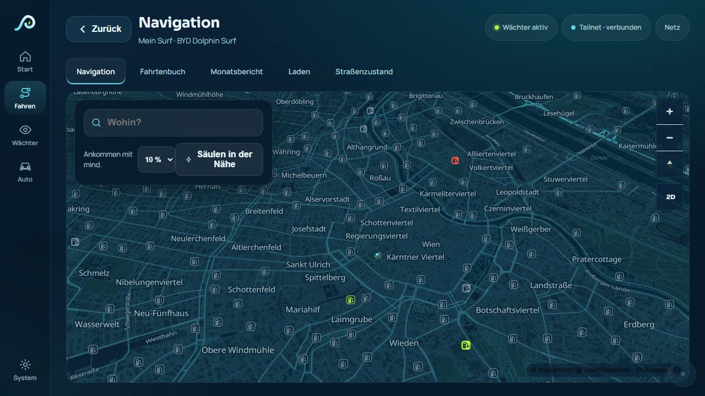 | 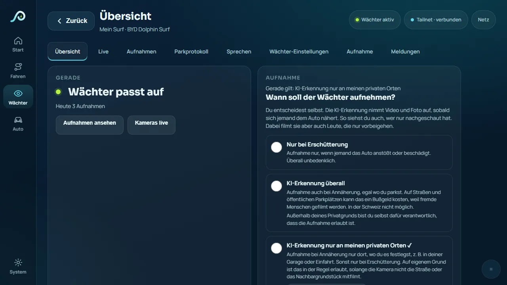 |
| Map with chargers nearby. | Guard: you choose when it records. |
| 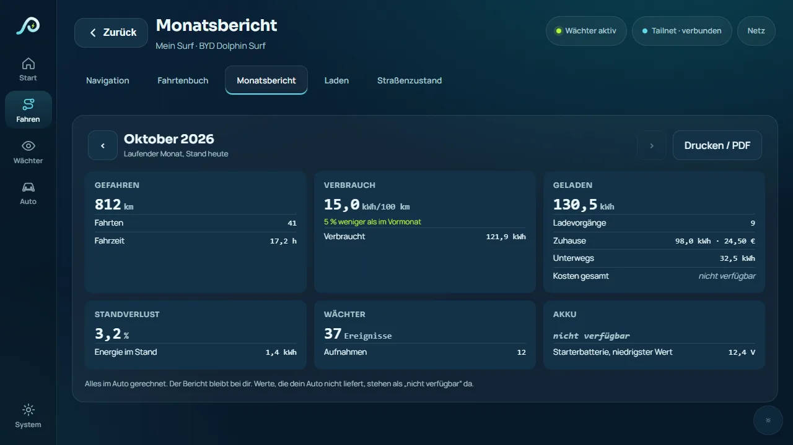 | 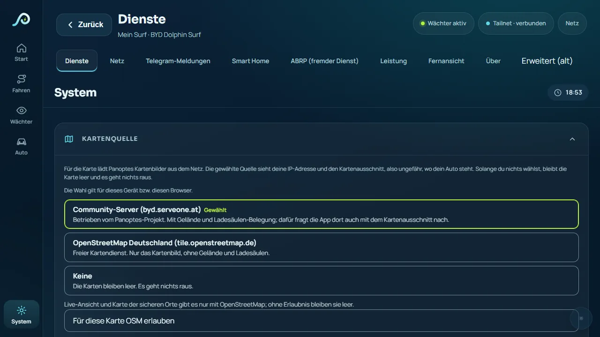 |
| Monthly report, calculated in the car. | Privacy: you choose where the map comes from. |

**On a phone and a PC:**

<p>
  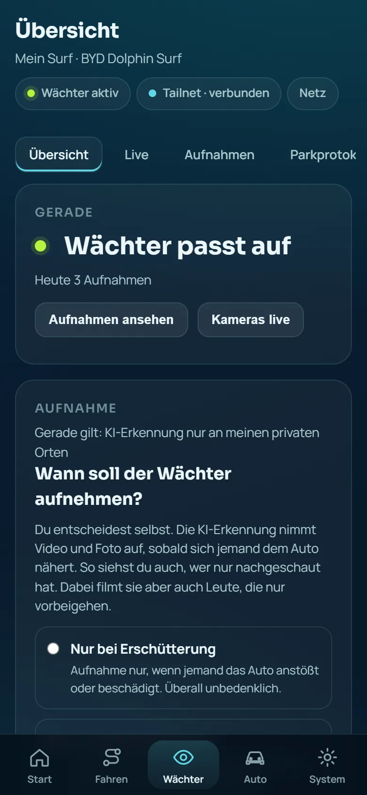
  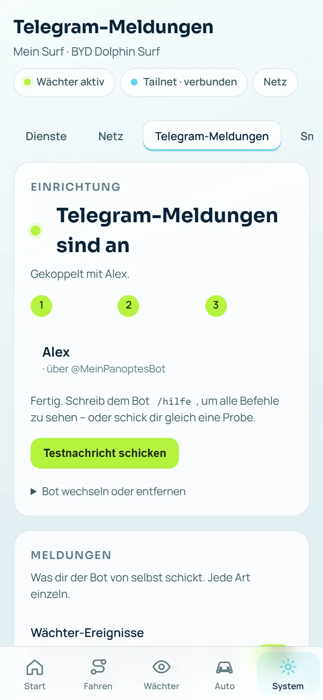
  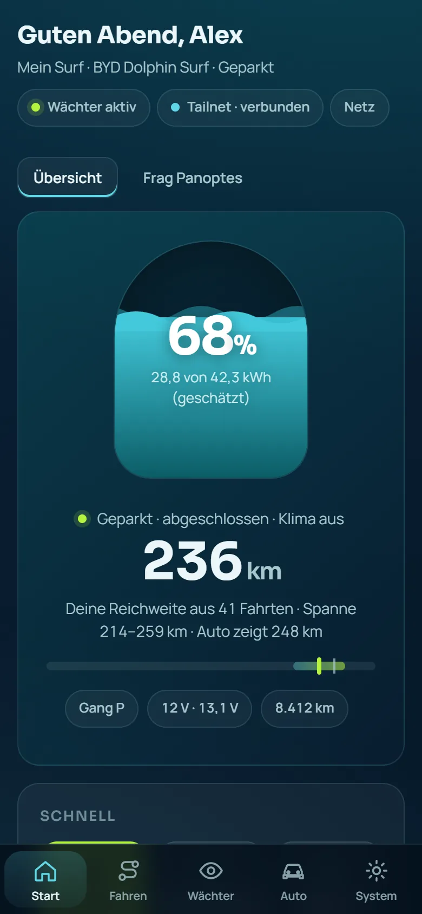
</p>
<p>
  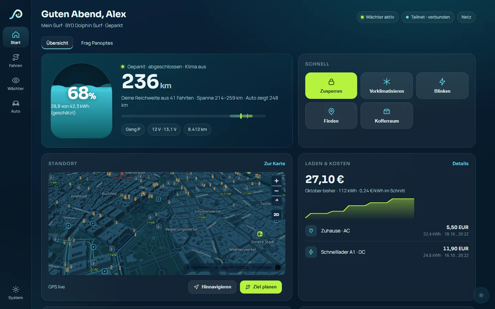
  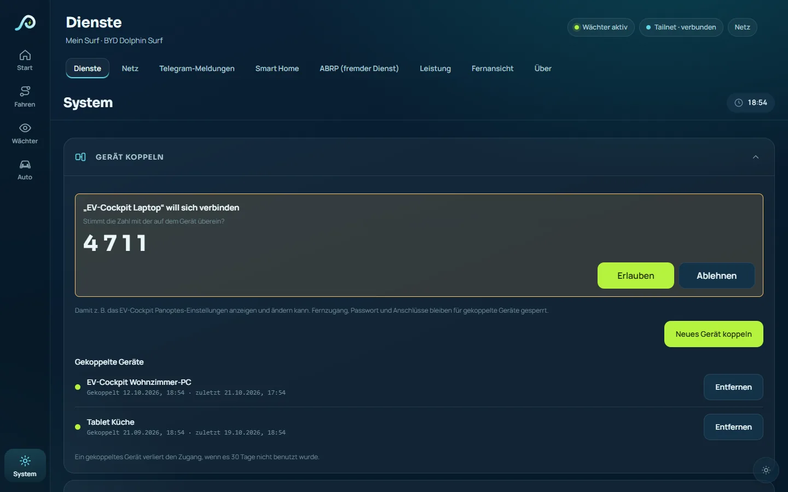
</p>

All pictures show sample data, not real vehicle data.

## What you need

- A BYD with DiLink 3, 4 or 5 and Android 9 or newer on the car screen.
- So far Panoptes has mainly been tested on the **BYD Dolphin Surf (DiLink 3)**. On other models some things may be missing or work differently. Panoptes hides features your car does not support.
- Storage for camera recordings, ideally a USB stick in the car.
- A free Tailscale account for remote access, and your own Telegram bot for notifications (Panoptes shows you how).

## Installation

> The detailed step-by-step guide for non-experts is on the [project page](https://byd.serveone.at/panoptes/en/#install). The way may differ slightly by model and software version.

1. **Download the app.** Get the latest `panoptes-….apk` under **[Releases](https://github.com/samuelvoltarius/panoptes/releases/latest)** and compare the sha256 checksum.
2. **Get it onto the car and install it.** How (USB stick, allow unknown sources) is explained on the [project page](https://byd.serveone.at/panoptes/en/#install).
3. **Go through the first start.** Panoptes guides you through setup:
   - **Autostart:** so Panoptes starts by itself when you get in, it has to be allowed in BYD's app management. Panoptes opens the right page for you. BYD resets this switch on every installation. After an update Panoptes turns it back on by itself; the BYD page shows briefly on the screen for that. If this fails, the home page shows the button “Turn autostart back on” and you get one message. Not needed on DiLink 5.
   - **Display over other apps:** needed for notices on the screen.
   - **Permission for Panoptes:** Android asks once "Allow USB debugging?". Choose **"Always allow from this computer"**. This lets Panoptes work in the background.
   - **Remote access:** scan the QR code on the car screen with your phone and sign in to Tailscale.
   - **Vehicle and cameras:** choose your model and battery size, then check the cameras.
   - **Confirm the notes.** The guard is suggested: on, recording only on impact. One tap confirms the legal note. You add AI detection yourself.
4. **Open it on your phone or PC.** Open your car's address in the browser (via Tailscale). To sign in you need the **access code**. You find it on the car screen under **Settings → Advanced (old) → Your access code**. If Telegram is set up, you can also sign in via Telegram with a check number.
5. **Pair other devices (optional).** Under **Settings → All settings → Pair a device** you can allow the EV Cockpit, for example. Paired devices cannot reach remote access, the password or ports, and you can remove them at any time.

## Updates

> **If you have 0.1.14.1:** install the current version (0.1.38.12) **once by hand**, just like the first time (your data is kept). 0.1.14.1 cannot update itself to 0.1.15 because from 0.1.15 on Panoptes is signed with a new, permanent key (APK signature scheme v3 with proof of origin from the old key). From 0.1.15 on, updates come automatically from this repository.

- New versions appear under **[Releases](https://github.com/samuelvoltarius/panoptes/releases)**, with a short list of what's new.
- Under **Settings → All settings → App updates** you can look for new versions and choose whether Panoptes only tells you or installs by itself.
- **When it installs:** never while driving. By itself only when the car has been off for at least 10 minutes. If you start an update yourself (there, on the car screen, in Telegram or on your phone), it runs right away when the car is in P and the guard is not recording, even with the ignition on. Otherwise Panoptes remembers it and installs about 10 minutes after you switch off. During the update the guard is off for a few minutes. If a new version does not run properly, Panoptes goes back to the previous one by itself.
- **Mobile data:** by default updates may also download over mobile data, because many cars only have the SIM. If you turn that off, Panoptes downloads only on Wi-Fi or asks you before that one download. The Panoptes Launcher follows the same rule.
- After an update Panoptes shows once what's new. If your car's software changes (BYD update), you get a notice.

## Privacy: what goes where

Principle: your recordings, trips and positions stay in the car. Panoptes does not send camera recordings to the project's servers. Anything that sends data out is off by default. Exception: if you set up Telegram, the guard sends its pictures along (can be turned off). You turn each item on separately, and Panoptes tells you beforehand where the data goes. You can turn it off at any time.

| Where | What | When |
|---|---|---|
| **In the car** (USB stick, app) | guard recordings, trip log, charging history, monthly report, settings | always. On a new setup Panoptes deletes recordings after 72 hours; you can keep individual ones. |
| **Map source** (community server byd.serveone.at or OpenStreetMap Germany) | your IP address and the map area, so roughly where your car is. With the community server also the query for free charging spots in that area. | only once you choose a source under **Settings → All settings → Map source**. On the car screen the choice applies to the whole car; phone and PC ask separately. |
| **Telegram** | message texts; guard pictures and clips (on by default, can be turned off; they are then stored on Telegram's servers) | only if you set up a bot |
| **Tailscale** | connection for remote access | only if you set up remote access |
| **Certificate for HTTPS in the tailnet** (Let’s Encrypt) | the device name and tailnet name become visible in public certificate logs | only if you turn on HTTPS in the tailnet for phone notifications |
| **Route planner** (byd.serveone.at/ev) | charge level, consumption factor, driving status; your approximate position only for a newly suggested charging stop. The trip log only when you request it yourself on /ev/, and only end-to-end encrypted: the planner only sees encrypted data. | only after linking, can be disconnected at any time; the trip log additionally only if you turn it on (off by default) |
| **Community server** (byd.serveone.at/community) | shared rules, only if you share them | off by default |
| **Open-Meteo** | approximate position for the weather | only with your consent, off by default |
| **Other services** (BYD account, MQTT/smart home, ABRP, Stadia Maps, AI assistant) | depends on the service; the input field tells you where your requests go | only if you set them up yourself |

No ads, no tracking.

## Source code

Panoptes is open source. This repository contains the complete source code of the app (Android app, background services and web interface) under the MIT License. Bundled third-party components keep their own licenses, see [THIRD_PARTY_NOTICES.md](THIRD_PARTY_NOTICES.md).

- Ready-to-install versions: **[Releases](https://github.com/samuelvoltarius/panoptes/releases)**.
- Bugs and ideas: **Issues**. Please do not report security issues publicly; see [SECURITY.md](SECURITY.md).
- The server side (map, route planner, community server on byd.serveone.at) is not part of this repository.

## Building it yourself

For developers. If you just want to use Panoptes, take the ready-made file under **[Releases](https://github.com/samuelvoltarius/panoptes/releases/latest)**.

You need:
- JDK 17 or newer,
- the Android SDK with platform 36 and build tools 36.0.0,
- Android NDK 26.1.10909125 and CMake (for the C++ camera and detection parts).

The Gradle wrapper (8.13) is included.

```bash
# point to your Android SDK (example)
echo "sdk.dir=/path/to/android-sdk" > local.properties
./gradlew assembleDebug
```

The APK ends up in `app/build/outputs/apk/debug/`. It is signed with your local debug key (`~/.android/debug.keystore`). If you don't have one yet, Android Studio creates it on the first build, or you create it yourself:

```bash
keytool -genkeypair -v -keystore ~/.android/debug.keystore -storepass android -alias androiddebugkey -keypass android -keyalg RSA -keysize 2048 -validity 10000 -dname "CN=Android Debug,O=Android,C=US"
```

**Important:** a self-built APK has a different signature than the official releases. Android therefore won't install it over an existing Panoptes installation. You have to uninstall Panoptes first, which removes its settings and data on the car.

Run the tests with `./gradlew testDebugUnitTest`. Some older tests currently fail.

The native components (Tailscale, WireGuard proxy) are included prebuilt in `app/src/main/jniLibs/`. You can build Tailscale yourself with `tools/build-libtailscale.sh` and the patches in `tools/patches/`; the WireGuard proxy lives in `tools/wireguard/`.

<a id="hinweise--disclaimer"></a>
## Notes / Disclaimer

**EN:** Private hobby project, free and without warranty. Use at your own risk, for private use with your own vehicle only. Users alone are responsible for lawful use (data protection, camera recordings, remote commands, traffic rules). Guardian recordings are intended for your own private property only, without capturing public space or neighbouring property. The speed camera display is off by default. In Germany, Switzerland, France and other countries it is forbidden while driving. Not legal advice, as of 10/2026. To the extent permitted by law, the developer accepts no liability; liability for intent, gross negligence, personal injury and mandatory consumer rights remains unaffected. Not affiliated with BYD; all trademarks belong to their owners. See also LICENSE.

**DE:** Privates Freizeitprojekt, kostenlos und ohne Gewähr. Nutzung auf eigenes Risiko und nur privat mit dem eigenen Fahrzeug. Für eine rechtmäßige Nutzung (Datenschutz, Kamera-Aufnahmen, Fernbefehle, Straßenverkehr) sind allein die Nutzer verantwortlich. Wächter-Aufnahmen sind nur für den eigenen Privatgrund gedacht, ohne öffentlichen Raum oder Nachbargrund. Die Blitzer-Anzeige ist standardmäßig aus. In Deutschland, der Schweiz, Frankreich und weiteren Ländern ist sie während der Fahrt verboten. Keine Rechtsberatung, Stand 10/2026. Soweit gesetzlich zulässig, übernimmt der Entwickler keine Haftung; Haftung für Vorsatz, grobe Fahrlässigkeit, Personenschäden und zwingende Verbraucherrechte bleiben unberührt. Nicht mit BYD verbunden; alle Marken gehören ihren Inhabern. Siehe auch LICENSE.

## License

- Panoptes' own code is licensed under the **MIT License** (see [LICENSE](LICENSE)), including the DiLink 5 camera library (own rewrite since 0.1.9).
- **The APK as a whole contains GPL-3.0 and AGPL-3.0 parts**: the separate program fast_cam_capture (GPL-3.0) and the YOLO detection models (AGPL-3.0). The complete source code is public; the license texts are included.
- Panoptes is based on the open-source project OverDrive (MIT License, © 2026 Yash Srivastava). Its license notice is retained.
- The app contains parts of other projects under their own licenses, for example Tailscale (BSD-3-Clause), OpenCV and TensorFlow Lite (Apache-2.0), OpenH264 (BSD-2-Clause), FAST_CAM_CAPTURE (GPL-3.0) and the YOLO11n/YOLO26n detection models (AGPL-3.0). The full list is in [THIRD_PARTY_NOTICES.md](THIRD_PARTY_NOTICES.md).
- Versions up to 0.1.7.x also contained sing-box (GPL-3.0), cloudflared and zrok (Apache-2.0). They were removed in 0.1.8.
- **Map data** © OpenStreetMap contributors, [ODbL](https://opendatacommons.org/licenses/odbl/).
- **3D car models:** partly by Nazh under [CC BY 4.0](https://creativecommons.org/licenses/by/4.0/), partly made by the project (CC0). Details: [byd.serveone.at/tiles/models/MODELLE_LIZENZEN.md](https://byd.serveone.at/tiles/models/MODELLE_LIZENZEN.md).
- **Charger data:** the source and license are shown in the app directly below the map.

## Links

- Route planner: [byd.serveone.at/ev/](https://byd.serveone.at/ev/)
- EV Cockpit (PC program): [byd.serveone.at/ev-cockpit/](https://byd.serveone.at/ev-cockpit/)
- Project page with installation guide: [byd.serveone.at/panoptes/](https://byd.serveone.at/panoptes/)
- Imprint: [byd.serveone.at/impressum](https://byd.serveone.at/impressum)
