# Panoptes

**Deutsch** · [English](README.en.md)

Panoptes ist eine kostenlose Community-App für BYD-Autos mit DiLink 3, 4 und 5. Sie läuft direkt am Bildschirm im Auto, mit großen Tasten für die Bedienung im Auto. Dazu kommt eine Weboberfläche, die du am Handy oder PC öffnest. Panoptes bietet einen Wächter mit Kamera, Fernzugang, Meldungen über Telegram, eine Karte mit Ladesäulen, einen Monatsbericht und eine Verbindung zum Routenplaner.

Hier liegt der Quellcode. Fertige Versionen zum Herunterladen gibt es unter **[Releases](https://github.com/samuelvoltarius/panoptes/releases/latest)**. Mehr zum Projekt und die Installationsanleitung: **[byd.serveone.at/panoptes/](https://byd.serveone.at/panoptes/)**.

Dieser Stand entspricht genau dem Release **v0.1.21** (interner Commit `b2b91f1`).

<p>
  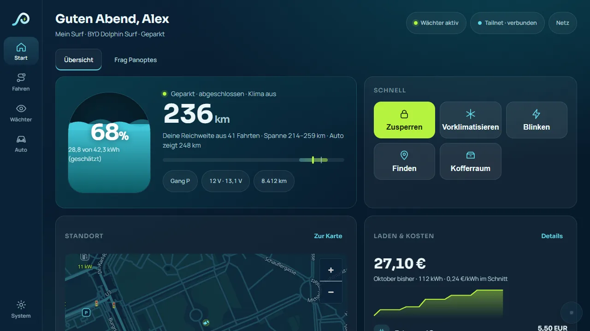
  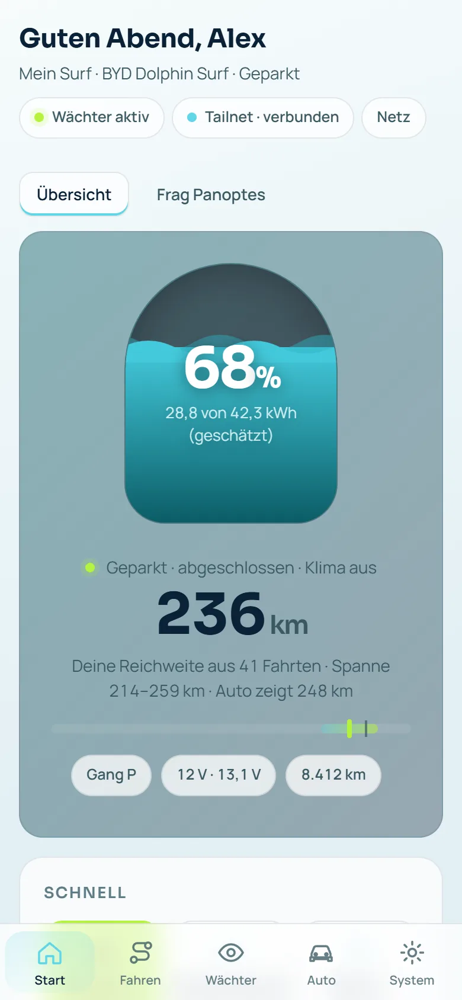
</p>

> **Wichtig:** Panoptes ist ein privates Freizeitprojekt und nicht von BYD. Bitte lies die [Hinweise](#hinweise--disclaimer) unten, bevor du es installierst.

---

## Was Panoptes kann

- **Am Bildschirm im Auto.** Panoptes läuft als eigene App im Vollbild, mit großen Tasten und einer Zurück-Taste. Während der Fahrt sind Einstellungen gesperrt; Start, Karte und Wächter bleiben erreichbar. Die Oberfläche passt sich an verschiedene Bildschirmgrößen an, auch im Hochformat.
- **Wächter mit KI-Erkennung.** Wenn dein Auto geparkt ist, achten die Kameras auf das Umfeld. Bei der Einrichtung wählst du selbst, wann aufgenommen wird: nur bei Erschütterung, mit KI-Erkennung überall oder mit KI-Erkennung nur an deinen privaten Orten wie Garage oder Einfahrt. Damit die Batterien geschont werden, legt sich der Wächter auf Wunsch schlafen, zum Beispiel bei wenig Ladestand oder schwacher Starterbatterie.
- **Fernzugang.** Über Tailscale erreichst du dein Auto von überall. Die Einrichtung läuft über einen QR-Code am Bildschirm im Auto, du verbindest es mit deinem eigenen Tailscale-Konto. Kann Panoptes die Schutzregel für den Fernzugang nicht setzen, schaltet es den Fernzugang ab, statt ihn ungesichert offen zu lassen.
- **Telegram-Meldungen.** Ein eigener Bot meldet dir, was am Auto passiert: Wächter-Ereignisse, Laden, schwache Starterbatterie, Reifendruck, Updates. Jede Meldungsart lässt sich einzeln ein- und ausschalten. Für die Nacht gibt es eine Ruhezeit. Bilder und Videos schickt der Bot nur, wenn du das ausdrücklich einschaltest.
- **Handy-Meldungen ohne Telegram.** Meldungen direkt aufs Handy brauchen eine HTTPS-Adresse. Mit Tailscale schaltet Panoptes dafür auf Wunsch HTTPS in deinem eigenen Tailnet ein: Dein Auto bekommt eine Adresse unter ts.net, die nicht öffentlich ist. Ohne Tailscale brauchst du eine eigene feste HTTPS-Adresse; Telegram geht immer.
- **Karte mit Ladesäulen.** Du wählst selbst, woher die Karte kommt: vom Community-Server des Projekts (mit Gelände und freien Ladeplätzen, wo Betreiber Daten liefern), von OpenStreetMap oder gar nicht. Solange du nichts wählst, bleibt die Karte leer.
- **„Reicht es noch?“** Wenn du eine Route aus dem Routenplaner geladen hast, sagt dir Panoptes unterwegs, ob der Akku bis zum nächsten Stopp reicht. Bei Bedarf schlägt es einen Ladestopp vor.
- **Monatsbericht.** Gefahrene Kilometer, Verbrauch, Laden und Kosten, Standverlust und Wächter-Ereignisse eines Monats auf einen Blick, auch zum Drucken. Gerechnet wird im Auto.
- **Fahrten und Laden.** Fahrten, Verbrauch und Ladekosten werden im Auto mitgeschrieben und übersichtlich angezeigt.
- **Verbindung zum Routenplaner.** Panoptes lässt sich mit deinem Konto auf [byd.serveone.at/ev/](https://byd.serveone.at/ev/) verbinden. Du lässt dir am Auto einen Code anzeigen und bestätigst ihn am Handy. Die Verbindung lässt sich jederzeit trennen.
- **EV-Cockpit am PC.** Das [EV-Cockpit](https://byd.serveone.at/ev-cockpit/) ist ein PC-Programm. Es zeigt Daten von Panoptes an und kann die Einstellungen von dort aus ändern. Das Koppeln bestätigst du mit einem Tipp und einer vierstelligen Prüfzahl.
- **Ehrlicher Verbindungsstatus.** Bei MQTT bzw. Smart Home siehst du, ob die Verbindung steht, gerade neu aufgebaut wird (mit ungefährer Zeit bis zum nächsten Versuch) oder aus ist.
- **Updates in der App.** Panoptes sucht auf Wunsch selbst nach neuen Versionen. Installiert wird nur, wenn das Auto steht und die Zündung aus ist.
- **Fünf Sprachen.** Deutsch, Englisch, Französisch, Italienisch und Niederländisch.
- **Home Assistant:** kommt bald.

## Screenshots

**Am Bildschirm im Auto** (1280 × 720):

| | |
|---|---|
| 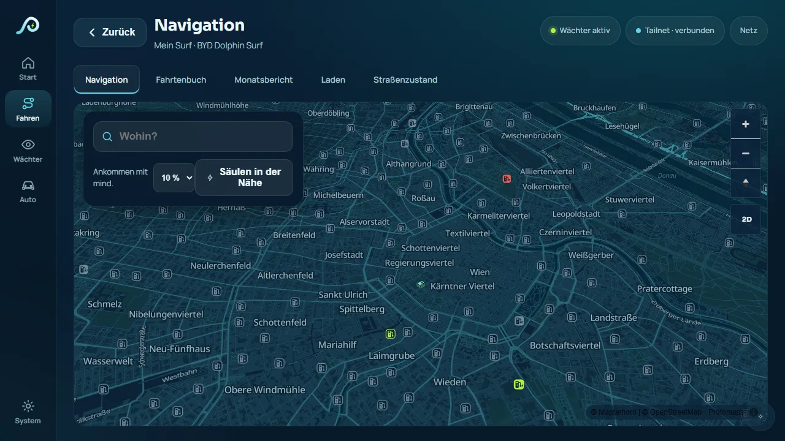 | 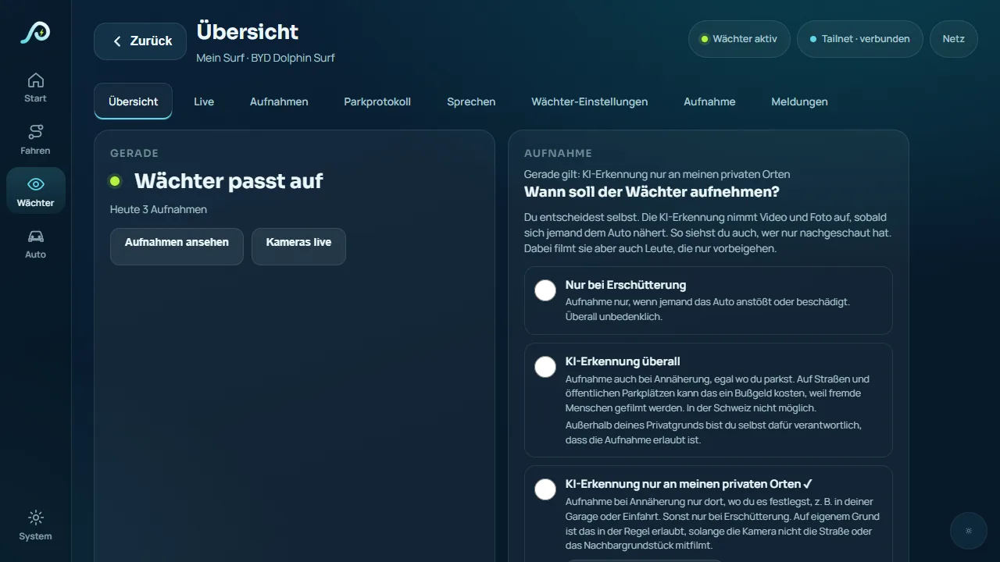 |
| Karte mit Ladesäulen in der Nähe. | Wächter: Du wählst selbst, wann aufgenommen wird. |
| 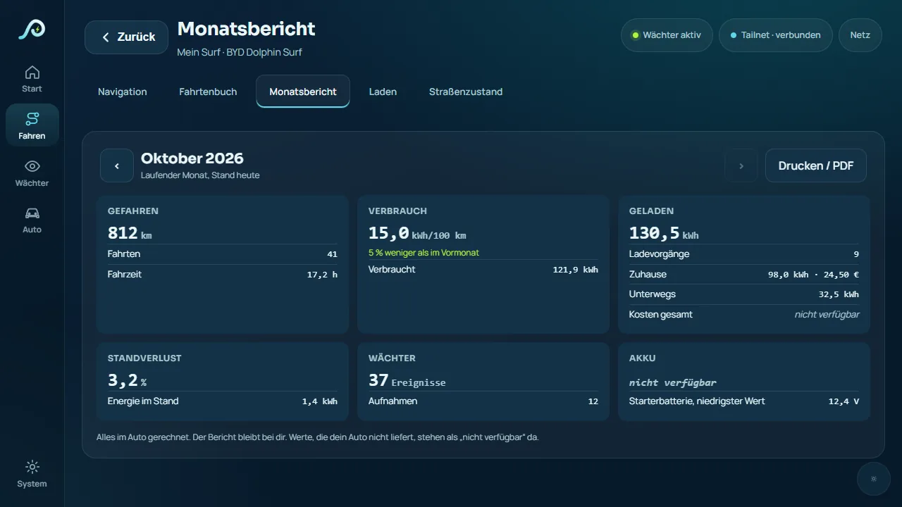 | 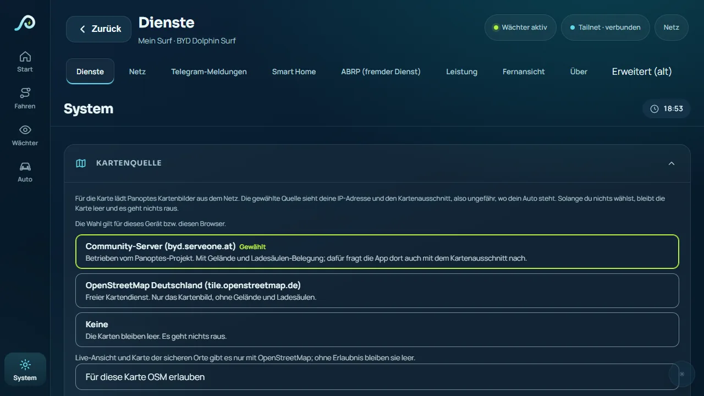 |
| Monatsbericht, im Auto gerechnet. | Datenschutz: Du wählst, woher die Karte kommt. |

**Am Handy und am PC:**

<p>
  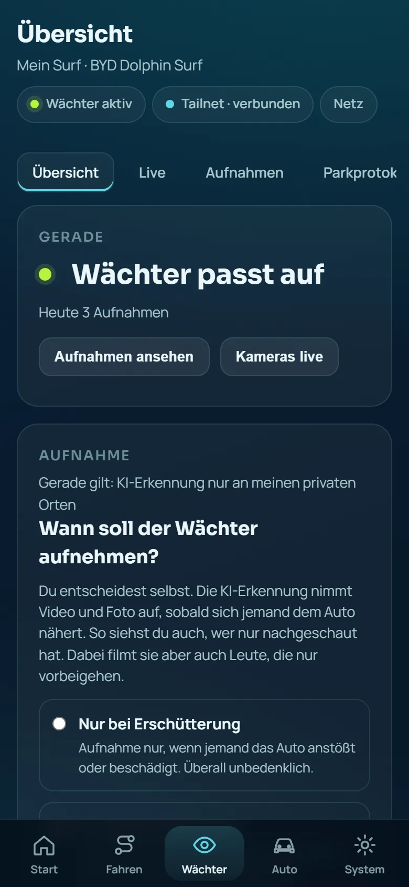
  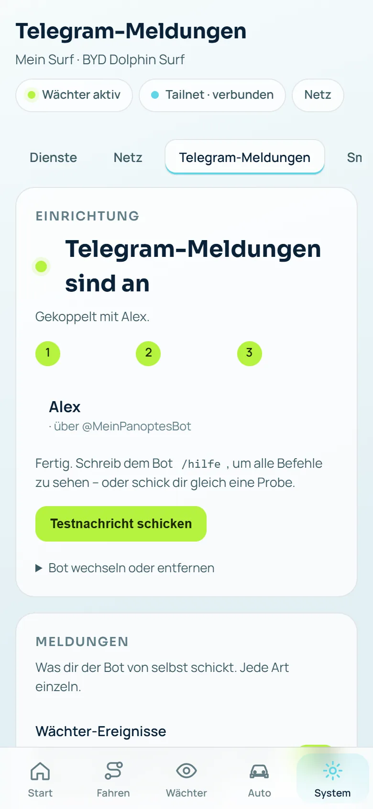
  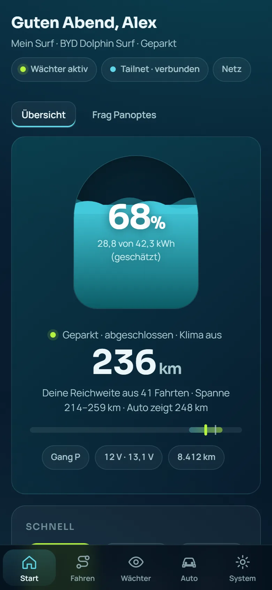
</p>
<p>
  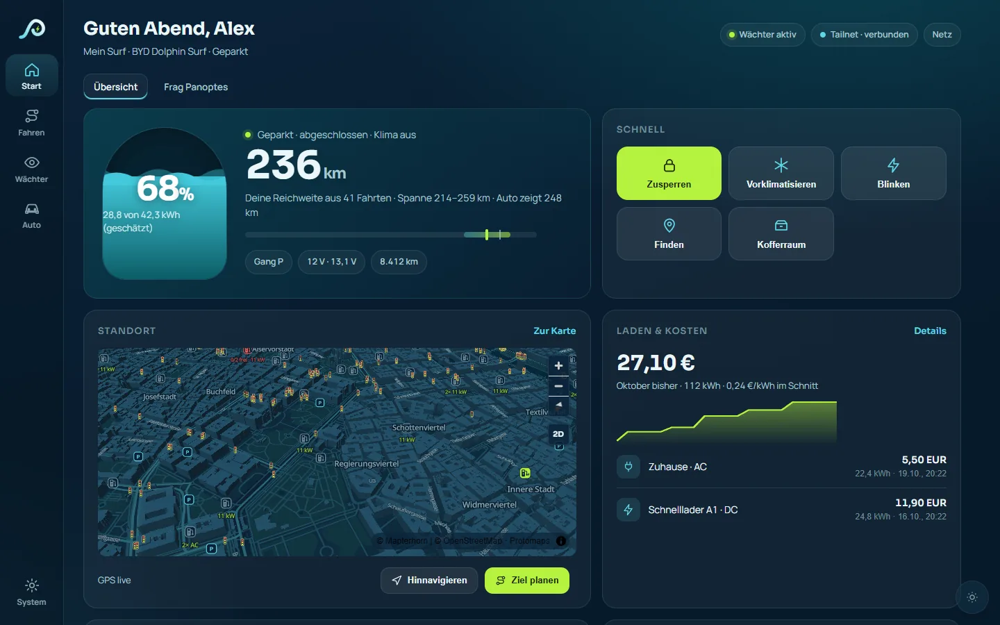
  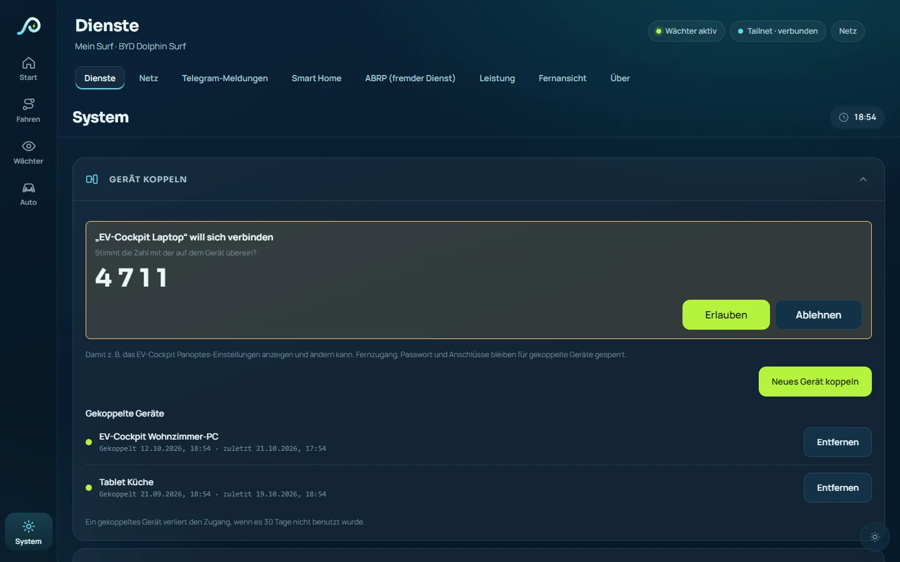
</p>

Alle Bilder zeigen Musterdaten, keine echten Fahrzeugdaten.

## Was du brauchst

- Ein BYD mit DiLink 3, 4 oder 5 und Android 9 oder neuer am Bildschirm im Auto.
- Getestet ist Panoptes bisher vor allem mit dem **BYD Dolphin Surf (DiLink 3)**. Auf anderen Modellen kann manches fehlen oder anders sein. Funktionen, die dein Auto nicht kann, blendet Panoptes aus.
- Speicherplatz für die Kamera-Aufnahmen, am besten ein USB-Stick im Auto.
- Für den Fernzugang ein kostenloses Tailscale-Konto, für Meldungen einen eigenen Telegram-Bot (Panoptes zeigt dir, wie das geht).

## Installation

> Die ausführliche Schritt-für-Schritt-Anleitung für Laien steht auf der [Projektseite](https://byd.serveone.at/panoptes/#installieren). Je nach Modell und Software-Stand kann der Weg etwas anders sein.

1. **App herunterladen.** Unter **[Releases](https://github.com/samuelvoltarius/panoptes/releases/latest)** die neueste Datei `panoptes-….apk` laden und die sha256-Prüfsumme vergleichen.
2. **Auf das Auto bringen und installieren.** Wie das geht (USB-Stick, unbekannte Quellen erlauben), steht auf der [Projektseite](https://byd.serveone.at/panoptes/#installieren).
3. **Ersten Start durchgehen.** Panoptes führt dich durch die Einrichtung:
   - **Autostart:** Damit Panoptes nach dem Einsteigen von selbst läuft, muss es in der BYD-App-Verwaltung erlaubt sein. Panoptes öffnet die richtige Seite für dich. BYD setzt diesen Schalter nach jedem Update zurück, Panoptes erinnert dich dann. Auf DiLink 5 entfällt der Schritt.
   - **Über anderen Apps anzeigen:** nötig für Hinweise am Bildschirm.
   - **Freigabe für Panoptes:** Android fragt einmal „USB-Debugging zulassen?“. Wähle **„Immer von diesem Gerät zulassen“**. Damit kann Panoptes im Hintergrund arbeiten.
   - **Fernzugang:** QR-Code am Bildschirm im Auto mit dem Handy scannen und bei Tailscale anmelden.
   - **Fahrzeug und Kameras:** Modell und Akkugröße auswählen, dann die Kameras prüfen.
   - **Hinweise bestätigen** und beim Wächter **selbst wählen**, wann aufgenommen wird. Hier gibt es keine Vorauswahl.
4. **Am Handy oder PC öffnen.** Rufe die Adresse deines Autos im Browser auf (über Tailscale). Zum Anmelden brauchst du den **Zugangscode**, den du in der App am Auto unter **Start → Zugangscode** findest.
5. **Andere Geräte koppeln (optional).** Unter **System → Gerät koppeln** erlaubst du zum Beispiel dem EV-Cockpit den Zugriff. Gekoppelte Geräte kommen nicht an Fernzugang, Passwort oder Anschlüsse und lassen sich jederzeit wieder entfernen.

## Updates

> **Wer 0.1.14.1 hat:** Installiere die aktuelle Version (0.1.21) **einmal von Hand**, genau wie beim ersten Mal (deine Daten bleiben erhalten). 0.1.14.1 kann sich nicht selbst auf 0.1.15 bringen, weil Panoptes ab 0.1.15 mit einem neuen, dauerhaften Schlüssel signiert ist (APK-Signaturschema v3 mit Herkunftsnachweis vom alten Schlüssel). Ab 0.1.15 kommen Updates automatisch aus diesem Repository.

- Neue Versionen erscheinen unter **[Releases](https://github.com/samuelvoltarius/panoptes/releases)**, mit einer kurzen Liste, was neu ist.
- Unter **System → App-Updates** kannst du direkt nach neuen Versionen suchen und wählen, ob Panoptes nur meldet oder selbst installiert. Installiert wird nur, wenn das Auto steht und die Zündung aus ist. Läuft eine neue Version nicht sauber, kehrt Panoptes von selbst zur vorigen zurück.
- Nach einem Update zeigt Panoptes einmal an, was neu ist. Ändert sich die Software deines Autos (BYD-Update), gibt es einen Hinweis.

## Datenschutz: was wohin geht

Grundsatz: Deine Aufnahmen, Fahrten und Positionen bleiben im Auto. Panoptes schickt keine Kamera-Aufnahmen an die Server des Projekts. Was Daten nach außen schickt, ist standardmäßig aus. Du schaltest es einzeln ein, und Panoptes sagt dir vorher, wohin die Daten gehen. Ausschalten geht jederzeit.

| Wohin | Was | Wann |
|---|---|---|
| **Im Auto** (USB-Stick, App) | Wächter-Aufnahmen, Fahrtenbuch, Ladeverlauf, Monatsbericht, Einstellungen | immer. Bei neuer Einrichtung löscht Panoptes Aufnahmen nach 72 Stunden, einzelne kannst du behalten. |
| **Kartenquelle** (Community-Server byd.serveone.at oder OpenStreetMap Deutschland) | Deine IP-Adresse und der Kartenausschnitt, also ungefähr, wo dein Auto steht. Beim Community-Server zusätzlich die Abfrage freier Ladeplätze für den Ausschnitt. | erst, wenn du unter **System → Kartenquelle** eine Quelle wählst. Am Bildschirm im Auto gilt die Wahl fürs ganze Auto; Handy und PC fragen getrennt. |
| **Telegram** | Meldungstexte; Bilder und Videos nur, wenn du das einschaltest (dann liegen sie auf den Servern von Telegram) | nur, wenn du einen Bot einrichtest |
| **Tailscale** | Verbindung für den Fernzugang | nur, wenn du den Fernzugang einrichtest |
| **Zertifikat für HTTPS im Tailnet** (Let’s Encrypt) | Gerätename und Tailnet-Name werden in öffentlichen Zertifikats-Verzeichnissen sichtbar | nur, wenn du für Handy-Meldungen HTTPS im Tailnet einschaltest |
| **Routenplaner** (byd.serveone.at/ev) | Ladestand, Verbrauchsfaktor, Fahrstatus; die ungefähre Position nur für einen neu vorgeschlagenen Ladestopp. Das Fahrtenbuch nur, wenn du es auf /ev/ selbst abrufst, und nur Ende-zu-Ende verschlüsselt: Der Planer sieht davon nur verschlüsselte Daten. | nur nach dem Verbinden, jederzeit trennbar; das Fahrtenbuch zusätzlich nur, wenn du es einschaltest (standardmäßig aus) |
| **Community-Server** (byd.serveone.at/community) | geteilte Regeln, nur wenn du sie teilst | standardmäßig aus |
| **Open-Meteo** | ungefähre Position für das Wetter | nur mit deiner Einwilligung, standardmäßig aus |
| **Weitere Dienste** (BYD-Konto, MQTT/Smart Home, ABRP, Stadia Maps, KI-Assistent) | je nach Dienst; an der Eingabe steht, wohin deine Anfragen gehen | nur, wenn du sie selbst einrichtest |

Es gibt keine Werbung und kein Tracking.

## Quellcode

Panoptes ist Open Source. Dieses Repository enthält den vollständigen Quellcode der App (Android-App, Hintergrunddienste und Weboberfläche) unter der MIT-Lizenz. Mitgelieferte Fremdbestandteile behalten ihre eigenen Lizenzen, siehe [THIRD_PARTY_NOTICES.md](THIRD_PARTY_NOTICES.md).

- Fertige Versionen zum Installieren: **[Releases](https://github.com/samuelvoltarius/panoptes/releases)**.
- Fehler und Vorschläge: **Issues**. Sicherheitslücken bitte nicht öffentlich melden, sondern wie in [SECURITY.md](SECURITY.md) beschrieben.
- Die Server-Seite (Karte, Routenplaner, Community-Server auf byd.serveone.at) ist nicht Teil dieses Repositorys.

## Selbst bauen

Für Entwicklerinnen und Entwickler. Wer Panoptes nur nutzen will, nimmt die fertige Datei unter **[Releases](https://github.com/samuelvoltarius/panoptes/releases/latest)**.

Du brauchst:
- JDK 17 oder neuer,
- Android SDK mit Plattform 36 und Build-Tools 36.0.0,
- Android NDK 26.1.10909125 und CMake (für die Kamera- und Erkennungs-Bausteine in C++).

Der Gradle-Wrapper (8.13) ist dabei.

```bash
# Pfad zum Android SDK eintragen (Beispiel)
echo "sdk.dir=/pfad/zum/android-sdk" > local.properties
./gradlew assembleDebug
```

Die APK liegt danach unter `app/build/outputs/apk/debug/`. Signiert wird sie mit deinem lokalen Debug-Schlüssel (`~/.android/debug.keystore`). Falls es den noch nicht gibt, legt Android Studio ihn beim ersten Bauen an, oder du erzeugst ihn selbst:

```bash
keytool -genkeypair -v -keystore ~/.android/debug.keystore -storepass android -alias androiddebugkey -keypass android -keyalg RSA -keysize 2048 -validity 10000 -dname "CN=Android Debug,O=Android,C=US"
```

**Wichtig:** Eine selbst gebaute APK hat eine andere Signatur als die offiziellen Releases. Android installiert sie deshalb nicht über eine vorhandene Panoptes-Installation drüber. Du musst Panoptes vorher deinstallieren, dabei gehen die Einstellungen und Daten am Auto verloren.

Tests laufen mit `./gradlew testDebugUnitTest`. Einige ältere Tests schlagen derzeit fehl.

Die nativen Bausteine (Tailscale, WireGuard-Proxy) liegen fertig gebaut unter `app/src/main/jniLibs/`. Tailscale lässt sich mit `tools/build-libtailscale.sh` und den Patches in `tools/patches/` selbst bauen, den WireGuard-Proxy findest du unter `tools/wireguard/`.

## Hinweise / Disclaimer

**DE:** Privates Freizeitprojekt, kostenlos und ohne Gewähr. Nutzung auf eigenes Risiko und nur privat mit dem eigenen Fahrzeug. Für eine rechtmäßige Nutzung (Datenschutz, Kamera-Aufnahmen, Fernbefehle, Straßenverkehr) sind allein die Nutzer verantwortlich. Wächter-Aufnahmen sind nur für den eigenen Privatgrund gedacht, ohne öffentlichen Raum oder Nachbargrund. Die Blitzer-Anzeige ist standardmäßig aus. In Deutschland, der Schweiz, Frankreich und weiteren Ländern ist sie während der Fahrt verboten. Keine Rechtsberatung, Stand 10/2026. Soweit gesetzlich zulässig, übernimmt der Entwickler keine Haftung; Haftung für Vorsatz, grobe Fahrlässigkeit, Personenschäden und zwingende Verbraucherrechte bleiben unberührt. Nicht mit BYD verbunden; alle Marken gehören ihren Inhabern. Siehe auch LICENSE.

**EN:** Private hobby project, free and without warranty. Use at your own risk, for private use with your own vehicle only. Users alone are responsible for lawful use (data protection, camera recordings, remote commands, traffic rules). Guardian recordings are intended for your own private property only, without capturing public space or neighbouring property. The speed camera display is off by default. In Germany, Switzerland, France and other countries it is forbidden while driving. Not legal advice, as of 10/2026. To the extent permitted by law, the developer accepts no liability; liability for intent, gross negligence, personal injury and mandatory consumer rights remains unaffected. Not affiliated with BYD; all trademarks belong to their owners. See also LICENSE.

## Lizenz

- Der eigene Code von Panoptes steht unter der **MIT-Lizenz** (siehe [LICENSE](LICENSE)), auch die Kamerabibliothek für DiLink 5 (seit 0.1.9 eigene Neufassung).
- **Das APK als Ganzes enthält GPL-3.0- und AGPL-3.0-Teile**: das eigenständige Programm fast_cam_capture (GPL-3.0) sowie die Erkennungsmodelle YOLO (AGPL-3.0). Der vollständige Quellcode ist öffentlich; die Lizenztexte liegen bei.
- Panoptes baut auf dem quelloffenen Projekt OverDrive auf (MIT-Lizenz, © 2026 Yash Srivastava). Dessen Lizenzhinweis bleibt erhalten.
- Die App enthält Bestandteile anderer Projekte, die unter ihren eigenen Lizenzen stehen, zum Beispiel Tailscale (BSD-3-Clause), OpenCV und TensorFlow Lite (Apache-2.0), OpenH264 (BSD-2-Clause), FAST_CAM_CAPTURE (GPL-3.0) sowie die Erkennungsmodelle YOLO11n/YOLO26n (AGPL-3.0). Die vollständige Liste steht in [THIRD_PARTY_NOTICES.md](THIRD_PARTY_NOTICES.md).
- Versionen bis 0.1.7.x enthielten außerdem sing-box (GPL-3.0), cloudflared und zrok (Apache-2.0). Ab 0.1.8 sind sie entfernt.
- **Kartendaten** © OpenStreetMap-Mitwirkende, [ODbL](https://opendatacommons.org/licenses/odbl/).
- **3D-Automodelle:** teils von Nazh unter [CC BY 4.0](https://creativecommons.org/licenses/by/4.0/), teils selbst erstellt (CC0). Details: [byd.serveone.at/tiles/models/MODELLE_LIZENZEN.md](https://byd.serveone.at/tiles/models/MODELLE_LIZENZEN.md).
- **Ladesäulen-Daten:** Die jeweilige Quelle und Lizenz steht in der App direkt unter der Karte.

## Links

- Routenplaner: [byd.serveone.at/ev/](https://byd.serveone.at/ev/)
- EV-Cockpit (PC-Programm): [byd.serveone.at/ev-cockpit/](https://byd.serveone.at/ev-cockpit/)
- Projektseite mit Installationsanleitung: [byd.serveone.at/panoptes/](https://byd.serveone.at/panoptes/)
- Impressum: [byd.serveone.at/impressum](https://byd.serveone.at/impressum)
